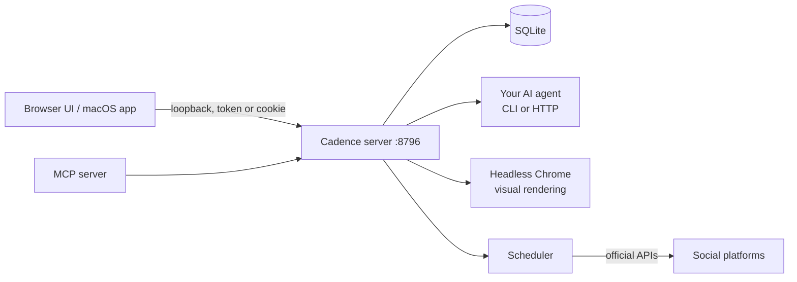

<p align="center">
  
</p>

<p align="center"><strong>Your brand, on beat.</strong><br>A local-first social media agent that runs on your own AI agent.</p>

<p align="center">
  <a href="https://github.com/jonacarbi/cadence/actions/workflows/ci.yml"></a>
  <a href="LICENSE"></a>
  
  
</p>

Paste a client's website. Cadence extracts the brand's design system, plans a month of posts with platform-specific copy and branded visuals, puts everything in an approval inbox, and publishes through official APIs once you approve. Everything runs on your machine. The writing is done by the AI agent you already use.

Landing page: https://cadence-social-agent.netlify.app

<!-- Screenshots go in docs/screenshots/ (inbox.png, plan.png, settings.png) -->
<p align="center"><em>Screenshots: add to <code>docs/screenshots/</code>.</em></p>

## Features

- **Brand from a URL.** Extracts colors, type, voice and audience, saves a reusable brand system, and judges a rendered sample against it.
- **Month plan.** Content pillars, a posting rhythm and per-platform copy, with Playwright-rendered visuals (editorial, carousel, square).
- **Approval inbox.** Preview, edit per platform, comment, regenerate from feedback, approve and schedule in one click. Nothing is published without approval unless you turn the autonomy dial up.
- **Safe publishing.** Official APIs only, per-account daily caps, minimum spacing, jitter, warm-up, never a blind retry. See [docs/SAFETY.md](docs/SAFETY.md).
- **Twelve platforms.** Instagram, Facebook, LinkedIn, X, Threads, Bluesky, Mastodon, Pinterest, TikTok, Reddit, Telegram, Discord.
- **Bring your own agent.** Claude Code, Codex, Gemini CLI, opencode, or any OpenAI-compatible endpoint.
- **Local-first.** SQLite database, encrypted account tokens, loopback-only server. No Cadence cloud.
- **Native Mac app and browser UI.** SwiftUI on macOS, a browser interface everywhere.
- **MCP server.** Let your coding agent plan and comment.

## Quick start

Requires Node 24 or newer and git.

```bash
git clone https://github.com/jonacarbi/cadence.git
cd cadence
npm run setup      # installs the server dependencies, then finds Chrome/Edge or downloads Chromium
npm start          # runs Cadence on http://127.0.0.1:8796 (leave this terminal open)
```

In a second terminal:

```bash
npm run open       # opens the web app in your browser, already signed in
npm run doctor     # checks Node, your text agent, browser, openssl and accounts
```

The first screen is a setup guide: pick your agent, add a brand from its website, connect accounts, set the safety dials.

To keep Cadence running in the background (it must be running for scheduled posts to go out):

```bash
node server/bin/cadence.mjs service install     # also: service status | service uninstall
```

**macOS.** `brew install node`. Service type: launchd agent `app.cadence.agent`. For the native app: `scripts/build-macos.sh`, then `open build/Cadence.app` (macOS 14+, Xcode command line tools).

**Linux.** Node 24 from nodejs.org or your package manager. Service type: `systemd --user` unit `cadence.service`. To keep it running after you log out: `loginctl enable-linger $USER`. Without a browser opener (`xdg-open`), `npm run open` prints the sign-in link instead.

**Windows.** `winget install OpenJS.NodeJS`, then run the commands in PowerShell. Service type: a Task Scheduler task named `Cadence` that runs at logon. Instagram, Facebook, Threads and TikTok sign-in also needs `openssl` (Git for Windows includes it, or `winget install ShiningLight.OpenSSL.Light`).

### The `cadence` command

`npm run setup|start|open|doctor|test` cover everyday use. The full CLI is `node server/bin/cadence.mjs <command>`:

| Command | What it does |
|---|---|
| `start [--port N]` | Run the server in this terminal |
| `open` | Open the web app, signed in (the server must be running) |
| `doctor` | Report Node, text agent, browser, openssl, certificate, accounts; prints MCP setup lines. Exit code 1 if something blocks Cadence |
| `browser` | Use an installed Chrome, Edge or Chromium, or download Playwright's Chromium (run by `npm run setup`) |
| `service install` / `uninstall` / `status` | Start at login via launchd, systemd --user or Task Scheduler |
| `mcp` | MCP server over stdio |
| `token` | Print the owner token (a secret: it can approve and publish) |

The shell scripts `scripts/install-service.sh` and `scripts/install-service.ps1` are wrappers for `service`.

Your data (database, brands, credentials, logs) lives in `~/Library/Application Support/Cadence` on macOS, `~/.local/share/cadence` (or `$XDG_DATA_HOME/cadence`) on Linux and `%APPDATA%\Cadence` on Windows. Set `CADENCE_DIR` to move it.

## Choose your agent

Open **Settings, AI agent** (or step 1 of the setup guide), pick one and press **Test**. The default is Claude Code with `claude-sonnet-5-5`; change it in the UI or with `CADENCE_TEXT_PROVIDER`, `CADENCE_MODEL`, `CADENCE_AGENT_CONTEXT` (see `.env.example`).

| Agent | Kind | Notes |
|---|---|---|
| Claude Code | CLI | Uses your plan or API key, with your skills and memory |
| Codex | CLI | |
| Gemini | CLI | |
| opencode | CLI | Pick a model from a provider you configured. OpenCode's free `opencode/*` models refuse runs that restrict tools, and Cadence always denies edit, shell and web |
| OpenAI-compatible | HTTP | OpenAI, OpenRouter, Ollama, LM Studio and others: base URL, key, model |

CLI agents are detected on your PATH (override with `CADENCE_CLAUDE_BIN`, `CADENCE_CODEX_BIN`, `CADENCE_GEMINI_BIN`, `CADENCE_OPENCODE_BIN`). Choose **full** context to let the agent use its own skills and memory, or **locked** to give it only what Cadence sends.

## Connect accounts

Most platforms need a developer app and some review apps before posting. Bluesky, Mastodon, Telegram and Discord need only a token or webhook. The **Accounts** screen and the setup guide show the exact redirect URI to paste into each developer portal. X, LinkedIn, Pinterest and Reddit use `http://127.0.0.1:8796/oauth/callback`; Instagram, Facebook, Threads and TikTok need `https://localhost:8797/oauth/callback`, served with a self-signed certificate Cadence creates for you (needs `openssl`). Step by step, including trusting the certificate: [docs/CONNECT-ACCOUNTS.md](docs/CONNECT-ACCOUNTS.md).

## Safety

Cadence reduces the risk of limits and bans; it cannot remove it. Official APIs only, human approval by default, daily caps, 90 minute minimum spacing, up to 7 minutes of jitter, 14-day warm-up for new accounts, backoff, and uncertain sends are never retried blindly. Details and limits: [docs/SAFETY.md](docs/SAFETY.md).

## Architecture



- `server/src` is the API, workflow, scheduler, brand and design loop, providers and MCP. No framework; `node:sqlite`.
- `server/web` is the browser UI. `mac/` is the SwiftUI app (SwiftPM, macOS 14+).
- `brand/` and `site/` are the identity assets and the landing page.

## Security model

Loopback only, Host header pinned to 127.0.0.1 or localhost on the real port, foreign Origins rejected. Owner and agent bearer tokens live in 0600 files; the agent role can draft and comment but never approve. The browser signs in with an HttpOnly, SameSite=Strict session cookie (7 days, kept in server memory, so a restart means running `npm run open` again) and every write needs an `X-Cadence-CSRF` header. Connected-account tokens are AES-256-GCM encrypted in the database; API keys, app client secrets and the webhook secret are sealed with the same key (`enc:v1:` values in the data folder's 0600 `.env`; plain values you type in by hand are sealed on the next start), so a copied or synced `.env` carries no usable credential. The key file `secret.key` sits beside it, so this guards against leaked copies, not against someone who can already read your user's files. Nothing secret is ever returned by the API. Website imports, source fetches and webhooks use validated, DNS-pinned, public-only requests. Asset reads reject path traversal. Report issues privately: [SECURITY.md](SECURITY.md).

## MCP

```bash
node server/bin/cadence.mjs mcp     # `npm run doctor` prints ready-made lines for Claude Code, Codex and Gemini
```

Cadence must be running. Add it as a stdio MCP server in Claude Code, Codex, Gemini or any MCP client. By default the agent token is used (drafts and comments only); set `CADENCE_MCP_ROLE=owner` to allow approval.

## Development

```bash
npm run setup
npm test
swift build --package-path mac          # macOS only
CADENCE_LIVE_SMOKE=1 node scripts/smoke-agent.mjs   # opt-in, uses your configured providers
```

See [CONTRIBUTING.md](CONTRIBUTING.md). Configuration lives in `.env` in the repo root or the data folder, or is written for you by the Settings screen (see `.env.example`); never commit real values.

## Roadmap

- Signed and notarized macOS release, Windows and Linux packaged installers
- Verified live publishing for every platform with real accounts
- Video support (needed for YouTube)

## License

MIT, see [LICENSE](LICENSE). Copyright 2026 Jonathan Carbiere.
